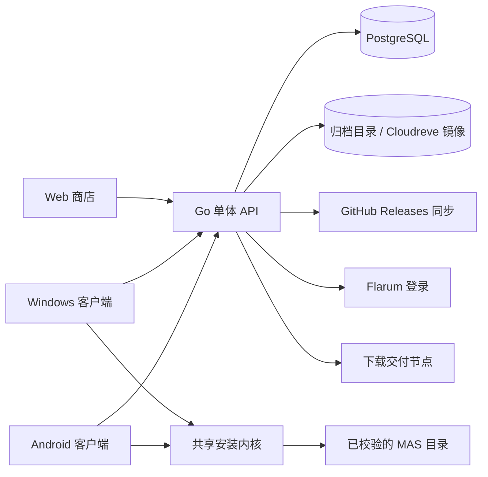

<div align="center">
  
  <h1>SubmodHub / RezeHub</h1>
  <p>面向 Monika After Story (MAS) 的子模组与精灵包集中商店</p>
  <p><code>v0.9.7</code> · Go 单体 API + PostgreSQL · React Web 商店 · Wails v3 Windows/Android 客户端</p>
</div>

---

## 这是什么

SubmodHub 是一个自托管的 **MAS 模组商店**：作者在网页工作台上传 ZIP，审核通过后版本进入公开目录；玩家用 Windows 或 Android 客户端浏览目录、安装、调整覆盖优先级、更新、卸载和故障恢复。

它要解决的是 MAS 自带 ZIP 安装器的三个老问题：

| 传统方式 | SubmodHub |
| --- | --- |
| 直接解压覆盖，不知道文件属于谁 | 每个已安装版本都有逐文件归属记录，卸载只删自己拥有的内容 |
| 两个模组写同一路径时互相覆盖 | 按优先级分层，同一路径由最高优先级模组生效，外部原有文件作为受保护的底层 |
| 装到一半断电/Ctrl-C，目录半成品 | 安装是带持久化 journal 的事务，重启后自动续做或回滚 |
| 靠论坛发帖分发，无法校验完整性 | 发布版本字节不可变，按 SHA-256 与大小校验 |

公开实例：`https://rezehub.0721play.icu`

> [!NOTE]
> 项目处于 `0.9.x` 快速迭代阶段，不做向后兼容承诺；数据结构变更通过一次性小脚本对目标服务器执行。

---

## 三端能力

### Web 商店（访客 / 作者 / 审核员 / 管理员）

- **访客**：目录支持关键词、分类（`submod` / `spritepack`）、平台、标签筛选与游标分页；详情页展示版本、依赖、兼容 MAS 范围、扫描摘要、ZIP 大小与 SHA-256，然后取下载描述符。
- **作者**：新建草稿 → 填写元数据与依赖 → 上传现有 ZIP（无需内置 manifest）→ 查看逐文件扫描报告与阻断原因 → 提交审核；也可以把 GitHub Release 资产导入为草稿，走同一套扫描与审核。
- **审核员**：查看包文件树、静态检测结果、脚本/二进制警告、重复注册名与 sprite `giftname` 冲突；写入批准或驳回理由，批准即发布。
- **管理员**：授予/撤销角色、下架版本（可恢复）、查看审核审计、配置 GitHub 代理、管理下载交付节点与 Cloudreve 镜像。

### 客户端（Windows / Android，Wails v3）

- **安装预览**：依赖阻断、语义冲突、将被覆盖的文件、外部文件备份、下载大小、剩余空间、最终生效层——确认后才写盘。
- **已安装 / 未托管**：区分托管版本与本地探测到的未托管子模组；未托管内容只提供查看或显式的「收养」流程，不能直接卸载。
- **优先级**：调整前先预览会改变哪些文件。
- **操作中心**：下载、扫描、备份、写入、提交的进度可视化；重启后按操作 ID 恢复；文件哈希漂移时暂停并展示预期/实测值，不自动覆盖。
- **自更新**：Windows 由独立的 `updater.exe` 在校验后替换本体；Android 通过侧载 APK 升级。

---

## 关键设计

**发布版本不可变。** 公开的 `version_id`、`sha256`、`size_bytes` 与 ZIP 字节在发布后不再变化；从目录移除只是可恢复的下架，不删除历史归档。静态扫描全程不执行 `.rpy`、`.rpym`、Python 或二进制文件，未知解析结果标记为 `unknown` 而不是「安全」。

**分层覆盖 + 外部文件保护。** 首次托管写入前先给目标路径拍基线；来源不明的既有文件被标记为 `external`，作为受保护的底层。之后每个路径的生效内容 = 优先级最高的已安装模组，平局按安装顺序与稳定 ID 决定。语义冲突（重复的 MAS 注册名、跨 JSON 的 `giftname`/sprite 身份重复）是阻断项，不会被文件排序"绕过"。

**安装是事务。** journal 状态机为 `planned → prepared → applying → committing → committed`，异常时进入 `rolled_back` 或 `needs_manual_recovery`。每一步都记录期望的旧/新哈希，写入前把将被替换或删除的文件快照进 blob store；所有写入都完成后再更新 manifest 与 receipt。Android 上不假设文件系统操作原子，靠同一套 journal 保证可恢复。

**精灵包是独立的发布形态。** 精灵包按 set/item 组织，支持按集合选择下载与预览；`giftname` 派生的 `.gift` 文件作为受管的派生输出记录归属，可回滚，也不会被写进存档目录。

---

## 系统架构



服务端是单个 Go 进程，负责目录、身份、投稿、审核、发布元数据与文件交付；安装逻辑在 `internal/install` 里被 Windows 与 Android 两个 Wails 外壳共用，通过绑定调用。

---

## 快速开始

### 玩家：安装客户端

1. 在 GitHub Releases 下载对应资产：
   - Windows x64：`submodhub-windows-amd64.exe`（便携单文件，另附 `updater.exe` 与 `SHA256SUMS.txt`）
   - Android arm64：`submodhub-android-arm64-<version>.apk`
2. 指向 MAS 目录：Windows 会自动探测已知安装位置，也可手动选择或管理多个实例；Android 固定根目录为 `/storage/emulated/0/MAS/`（游戏文件在其 `game/` 下）。
3. Android 11+ 需要授予「所有文件访问权限」，未授权时客户端不会读写托管文件。

> [!IMPORTANT]
> 安装会真实写入游戏目录。请先退出 MAS；重要存档自行备份。

### 作者：发布一个子模组

1. 用 Flarum 论坛账号登录（仅作者、审核员、管理员需要登录；访客可直接浏览下载）。
2. 新建草稿，填写标题、简介、分类、标签、支持平台、兼容 MAS 范围与依赖。
3. 上传现有的 ZIP 包，等待静态扫描。
4. 按报告修复阻断项（越界路径、符号链接、重复路径、重复注册名等），再提交审核。
5. 审核通过后自动发布；驳回时理由会记录在提交历史里，可以修订后再提交。

### 自托管：Docker Compose

```powershell
Copy-Item deploy/.env.example deploy/.env
docker compose --env-file deploy/.env -f deploy/compose.yaml up -d --build
Invoke-WebRequest http://127.0.0.1:18082/healthz
```

> [!WARNING]
> `deploy/compose.yaml` 默认把端口绑到 Tailnet 地址 `100.72.137.92`，换主机请先改绑定地址。生产环境登录必须走 HTTPS；`SUBMODHUB_ALLOW_INSECURE_AUTH` 只给直连 HTTP 测试源站用，不要用于公开构建。

### 本地开发

```bash
# 服务端与共享内核（根 module）
go test ./...
go run ./cmd/server                    # 默认 :8080；设置 POSTGRES_DSN 用 PostgreSQL，否则用本地 JSON 快照

# Web 商店
cd web && npm install && npm run dev   # :3000，/api 代理到 SUBMODHUB_API_TARGET

# 客户端（独立 Go module，需要 wails3 CLI）
cd cmd/client/SubmodHub && wails3 dev

# Android APK：通过 SSH 在 Linux 主机上交叉编译
./build-android.bat [REMOTE_HOST] [arm64|amd64]
```

---

## 仓库结构

| 路径 | 说明 |
| --- | --- |
| `api/openapi.yaml` | REST 契约（`/api/v1`） |
| `cmd/server` | API 单体入口，支持 `healthcheck` 子命令 |
| `cmd/client/SubmodHub` | Wails v3 客户端与打包配置（独立 Go module） |
| `cmd/download-node` | 独立下载交付节点（票据中转） |
| `cmd/updater` | Windows 自更新执行器 |
| `cmd/version` | 读取、校验、升级版本号 |
| `cmd/{backfill-mod-created-at,delivery-rekey,cloudreve-probe}` | 一次性运维工具 |
| `internal/httpapi` | 路由、会话、投稿、审核、设置、交付接口 |
| `internal/auth` | Flarum 登录与组→角色映射 |
| `internal/install` | 安装内核：计划、事务、备份、修复、收养、优先级 |
| `internal/package` | ZIP 安全校验、包结构扫描、精灵包解析 |
| `internal/maspath` | MAS 路径映射（含 Android 固定根目录） |
| `internal/solver` | 依赖求解 |
| `internal/github` | Releases 同步与代理中转 |
| `internal/cloudreve` | 网盘镜像读写 |
| `internal/delivery` | 交付节点票据、密钥与中转 |
| `internal/updater` | 客户端自更新状态机（含 Windows 实现） |
| `web/` | Web 商店前端（React 19 + Vite + Tailwind 4） |
| `clients/desktop/` | 客户端 UI 源码，作为 Wails 前端根目录 |
| `ui/` | Web 与客户端共享的 TypeScript API 客户端 |
| `deploy/` | Compose、Dockerfile、nginx 与交付节点编排 |
| `docs/` | 契约、运维、交付、版本与 Aegis 记录 |

---

## 环境变量

**API 服务端**

| 变量 | 默认 | 说明 |
| --- | --- | --- |
| `SUBMODHUB_ADDR` | `:8080` | 监听地址 |
| `SUBMODHUB_DATA_DIR` | — | 归档与本地快照目录（容器内 `/data`） |
| `POSTGRES_DSN` | 空 | 为空时退化为本地 JSON 快照存储 |
| `FLARUM_URL` | 空 | 论坛地址；留空则不启用论坛登录 |
| `ADMIN_FLARUM_GROUP_IDS` | 空 | 自动映射为 `admin` 的 Flarum 组 ID，如 `16,22` |
| `SUBMODHUB_AUTO_PUBLISH` | `false` | `true` 时跳过人工审核直接发布 |
| `SUBMODHUB_UPLOAD_TOKEN` | 空 | 直接上传令牌 |
| `GITHUB_SYNC_INTERVAL` | `0`（关闭） | 旧的后台轮询间隔；默认关闭，版本按需抓取。设为 `15m` 可恢复轮询 |
| `GITHUB_SYNC_TTL` | `30m` | 按需抓取的新鲜度窗口：有人查看模组时，距上次同步超过该值才回源。`0` 表示只有显式「立即同步」才回源 |
| `SUBMODHUB_DELIVERY_MASTER_KEY` | 空 | 交付凭据主密钥（32 字节 base64），为空则无法保存新凭据 |
| `SUBMODHUB_TEST_MODE` | `false` | 测试账号模式，仅限本地/测试环境 |

**Web 前端**：`SUBMODHUB_API_TARGET`（dev 代理目标）、`VITE_ALLOW_INSECURE_AUTH`（仅 HTTP 测试源站）。

**GitHub API 令牌**：不在环境变量里配置，改由管理端「系统设置 → GitHub API 令牌」维护（保存即生效，无需重启）。未配置时所有请求共用匿名配额 60 次/小时/IP，配置后为 5000 次/小时。令牌只发给 GitHub API 主机，不会随资产下载外泄；配置了 `SUBMODHUB_DELIVERY_MASTER_KEY` 时加密落盘，否则明文存储并在设置页明确标注。

**下载交付节点**：`DOWNLOAD_NODE_ADDR`、`DOWNLOAD_NODE_ID`、`DOWNLOAD_NODE_KEY`、`DOWNLOAD_NODE_GITHUB_PROXY`、`DOWNLOAD_NODE_CONCURRENCY`。

---

## 版本号

仓库根目录的 `VERSION` 是唯一权威来源，其余位置由工具同步，不要手改：

```bash
go run ./cmd/version          # 当前版本
go run ./cmd/version -check   # 校验 VERSION 与派生文件一致（CI 会执行）
go run ./cmd/version -set 0.9.8
```

推送到 `main` 后，CI 构建 Windows / Android 客户端，并为 `vX.Y.Z` 创建附着产物的 GitHub Release。Android `versionCode` 由版本号推导为 `MAJOR*10000 + MINOR*100 + PATCH`。

---

## 文档

| 文档 | 内容 |
| --- | --- |
| [docs/frontend-contract.md](docs/frontend-contract.md) | 页面能力、DTO、REST 路由与客户端绑定契约 |
| [docs/operations.md](docs/operations.md) | Docker 部署、自动发布、GitHub 同步运维、事务恢复 |
| [docs/download-delivery.md](docs/download-delivery.md) | 交付节点、Cloudreve 镜像、主密钥与备份 |
| [docs/github-release-source.md](docs/github-release-source.md) | Releases 源同步配置、正则示例、代理与排障 |
| [docs/app-update.md](docs/app-update.md) | 客户端自更新架构与发布资产命名 |
| [docs/VERSIONING.md](docs/VERSIONING.md) | 版本号系统与 CI |
| [docs/android-smoke.md](docs/android-smoke.md) | Android 存储权限可行性验收 |
| [docs/aegis/INDEX.md](docs/aegis/INDEX.md) | 设计规格、实施计划与架构决策记录索引 |

---

## 已知边界

- 对象存储只实现了本地归档目录与 Cloudreve 镜像，S3/MinIO 适配尚未实现。
- 登录目前只接 Flarum，GitHub OAuth 暂缓；GitHub 用于 Releases 源同步。
- Wails v3 的 Android 支持仍属实验特性，存储访问依赖系统「所有文件访问权限」，且只验证固定根目录。
- 交付范围的客户端是 Windows 与 Android；macOS / iOS / Linux 的打包配置存在但不在交付范围内。
