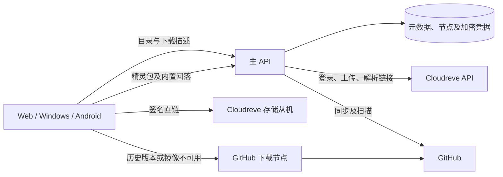

# API 与下载交付分离、Cloudreve 镜像及节点统一管理实施计划

日期：2026-10-20
状态：用户随后授权实施，七个阶段的代码与本地验证已推进；真实Cloudreve、设备、部署和资源验收尚未齐备，整项保持待验收。未部署远端。

实现与证据见 [执行检查点](../work/2026-10-20-download-delivery-nodes/20-checkpoint.md) 和 [下载交付运维](../../download-delivery.md)。

## Goal

通过 Web 管理多个下载节点及 Cloudreve 网页/API 登录凭据，使 GitHub 最新已发布版本和站内上传的非精灵包通过外部交付链路下载，减少主服务器重复传输归档的带宽。精灵包继续保存在主服务器并在主服务器生成选取包。WebDAV 暂不接入。

## Architecture

主 API 是目录、身份、发布状态、不可变版本哈希、节点配置和镜像状态的唯一权威。下载描述接口解析交付路径，优先返回 Cloudreve 签名直链；GitHub 转发节点仅在需要时传输字节。主服务是不可删除的内置节点，无适用外部节点时负责解析或原有传输。

Cloudreve 是交付提供方，其 API 地址与实际存储下载域名允许不同。它与轻量 GitHub 转发节点是两类节点，不强行让 Cloudreve 运行本项目的节点程序。资源来源 `github_releases/local` 和交付能力 `github/cloudreve` 分离；此前讨论的 `webdav` 能力本期不实现。

## Tech Stack

现有 Go 1.25、net/http、PostgreSQL catalog_snapshot、本地 JSON store、React/TypeScript Web 设置、Wails Windows/Android 共用 Go 下载流程、Docker Compose。新增 Cloudreve v3 客户端和轻量 Go 下载节点；不新增 Redis、消息队列或通用存储框架。

## Baseline / Authority Refs

- 本次用户确认：多节点可在 Web 增删改、声明能力；无节点时主服务作为节点；使用 Cloudreve API；GitHub 最新版镜像；精灵包本地；暂不处理 WebDAV；登录凭据将通过 Web 配置。
- [原始设计](../specs/2026-09-25-submodhub-design.md)：不可变版本、公开下载、角色与发布边界。
- [原 GitHub 代理计划](2026-10-08-github-proxy-relay.md)：本计划实施后替代其中强制同源下载的约束，不更改已有 GitHub 出站代理职责。
- [运维](../../operations.md)、[前端契约](../../frontend-contract.md)、[GitHub 源](../../github-release-source.md)。
- 实现基线：`internal/httpapi/server.go`、`settings.go`、`postgres.go`、`github_sync.go`、`github_relay.go`、`spritepacks.go`；`internal/github/releases.go`；`cmd/client/SubmodHub/archive_transfer.go`；`ui/settings-api.ts`；`web/src/components/AdminPanel.tsx`。
- TaskStartSnapshot：规划时 `git status --short` 为空，HEAD 为 `98f7135`。执行时必须重新记录；不要覆盖后续用户改动。

## Compatibility Boundary

- 版本 ID、SHA-256、大小、审核及上下架规则仍由主 API 决定；外部镜像不能改写已发布内容。
- 下载描述允许 HTTPS 跨域交付，Windows/Android 下载校验及重定向策略同步更新；无需维护旧客户端的同源契约兼容分支。
- 精灵包原始归档、预览、选取打包和安装流程保留本地；本期不做精灵包外部交付及 WebDAV 备份。已讨论的原始包容灾备份延期，不算本期交付。
- 客户端应用自身更新 `internal/updater` 不在本期，范围仅商店内容包下载。
- 不在本轮部署、批量删除旧归档、删除旧镜像或更改生产数据。

## Requirement Ready Check / Change Necessity

已确认的场景覆盖管理员配置、GitHub 新版同步、普通包上传、客户端直连、精灵包本地、无节点回落。网页独立认证与大文件上传属于必须实测的实施条件，凭据由管理员之后提供，不依赖会话中的密码。

单纯更改代理或域名不能解决当前 API 中转，也不能绕过客户端跨域拒绝；最小改造边界为设置、Cloudreve 客户端、镜像任务、下载描述及客户端 URL 策略。当前下载和同步都位于 API，继续把所有新逻辑塞入已有大型 `server.go` 会混合职责，新增专责文件，入口仅接线。

本计划中权重、短期授权、任务持久化及加密方式是可审阅的实施默认值，不代表这些尚未实现。若实例必须交互验证码/MFA，先返回需要管理员处理，不通过自动化绕过认证。

## 实测依据与限制

- 正式 Web API：`https://disk.monika.love/api/v3`；WebDAV 地址不作为 Cloudreve API 地址。
- 浏览器已有登录会话下，35 字节测试文件上传成功；`PUT /file/download/{id}` 返回业务码 0 和签名直链。
- 对实际从机 `disk.edgemonix.top:29991` 使用 `credentials: omit` 下载成功，200、35 字节、内容一致。
- 发送 Range 且禁用缓存仍返回完整 200；首版不承诺断点续传，不将完整响应追加到部分文件。
- 给出的 WebDAV 凭据在正式 Web API 独立登录失败；不能视作可用网页密码。
- 未证明：128 MiB 归档上传、重启后的独立登录、会话续期、签名有效期契约、并发及限流。
- 两次测试文件均已删除并确认不存在。计划不记录凭据、Cookie、完整签名 URL。

## 节点和凭据契约

### 统一 Web 管理

- 内置节点固定展示，不可删除；外部节点支持创建、编辑、启停、删除、连接测试。
- 公共字段：ID、名称、类型、启用、权重、能力、revision、最近检测时间、状态和脱敏错误。
- 类型 `github_relay`：公开 HTTPS 服务地址、GitHub 能力、节点授权密钥；支持多实例。
- 类型 `cloudreve`：API 基地址、用户名、密码、项目专用目录、下载主机允许列表、Cloudreve 能力；支持多实例。
- 编辑密码留空代表保留原值；替换密码需明确输入；读接口仅返回 `credential_configured`，不回传密码或密文。
- 能力由类型约束，不能勾选实现不支持的能力。UI 使用“GitHub 转发”“Cloudreve 存储与直链”，不把源类型误当交付方式。
- “测试连接”默认只做认证及目录权限检查；完整上传/下载/删除测试需明确展示会创建临时文件。失败保留非敏感表单输入；密码测试后清除；保存成功、认证失败、权限不足、冲突、超时分开反馈。
- 删除节点只删除配置、凭据并退出调度，不删除网盘对象。最后一个节点移除时，展示主服务器带宽回落提示。

### 服务端保护

凭据在服务端使用 AEAD 加密后存入持久化，主密钥仅从部署环境加载。没有主密钥时禁止保存新秘密，不允许退回明文；重启验证可解密，换密钥必须有显式重加密操作。JSON store 与 PostgreSQL 同规则。数据库备份必须配合密钥备份才可恢复。

会话 Cookie 仅保留于服务端内存，按节点做独立 Cookie jar、登录互斥和单次失效重登；不把网页会话下发客户端。密码变更或节点删除使旧会话失效。日志、审计、设置 GET、作者/公开版本 DTO 不得含密码、Cookie、密钥、签名 URL 或内部对象定位。

复用管理员权限、CSRF、同源检查与 revision 乐观锁。配置与密文保存失败应回滚内存。节点测试、重定向和下载解析都限制目标，不允许用户任意 URL 取流。Cloudreve API 重定向不得把认证头/Cookie 带到存储主机；私网节点仅允许管理员明确配置的目标。

## 交付与镜像策略

1. **GitHub 普通包最新版**：现有下载/扫描得到的同一文件上传 Cloudreve；对象键包含 mod/version/SHA-256，保存节点 ID、文件 ID、大小及发布哈希。只对当前最新已发布版本保证镜像，后台跟踪 mark-latest/同步变化，旧任务完成不能把新 latest 覆盖掉。
2. **站内普通包**：上传扫描后在本地保留归档，后台复制到启用的 Cloudreve 节点，镜像 ready 后优先外部交付。首版不自动删除本地原件，避免将存储迁移和带宽分离耦合。
3. **精灵包**：不进入镜像调度；继续本地归档及动态选取 ZIP，下载能力改变不得误路由整包或选取包。
4. **无节点**：维持当前本地/GitHub 中继行为。Cloudreve 失效先尝试其他 ready 镜像或 GitHub 节点，最终回落内置节点；设置与诊断明确显示发生回落及原因。
5. **多个 Cloudreve 节点**：当前最新及普通包以后台限并发方式逐步复制到每个启用且可写节点；请求只在该对象 ready 的节点中按权重选择，禁止选中仅有配置却无文件的节点。新增节点触发最新 GitHub 普通包和当前发布站内普通包的补齐，不自动搬运全部 GitHub 历史版本。
6. **失败与恢复**：镜像失败不撤销已发布版本；持久化 pending/uploading/ready/failed、重试时间、次数和脱敏错误，退避并限制重试；启动恢复 uploading。上传成功后落库失败需按对象键对账，避免重复上传。
7. **校验**：Cloudreve 元数据大小不是 SHA-256 证明。首个实测阶段确认服务端可信哈希能力；没有时镜像首次 ready 前通过独立读回流式计算 SHA-256（仅同步时一次），不缓存进内存。客户端始终按 API 发布哈希验收。
8. **存储清理**：旧镜像先保留；自动清理、引用追踪及删除策略后续独立确认。本期不得在 latest 切换时删除仍有签名链接的对象。

## 下载与轻量节点协议

保留 `GET /api/v1/versions/{id}/download` 作为唯一解析入口，返回 `url, expires_at, sha256, size_bytes, delivery_type, node_id, allowed_download_origins`。Cloudreve 返回地址的签名有效期需查证，不能继续伪造固定 15 分钟；描述有效期取提供方可靠到期时间减安全裕量与本站描述 TTL 的较小值。无法取得可信有效期时，该提供方暂不进入 ready 直链调度，返回明确诊断并使用其他节点或内置路径，待步骤 1 确认协议后再启用。

GitHub 节点仅接收主 API 签发的短期票据（节点受众、版本 ID、源 URL、哈希、大小、到期时间）；白名单验证 GitHub/CDN 及重定向目标，拒绝任意网址。节点不接数据库、Cloudreve 密码或用户会话。

客户端允许 API 描述声明并通过规则校验的外部 HTTPS origin，拒绝 userinfo、协议相对 URL、HTTPS 降级及未授权跳转。不把 API 的 Cookie/Authorization 复制到外部请求。CDN 跳转允许列表来自配置的提供方策略，不接受任意公网跳转；拒绝私网目标（本地测试显式隔离）。依旧校验大小、SHA-256、配额、取消和超时；过期/失败重新取描述，限定尝试次数，不重试哈希不一致安装。

下载描述签发只表示一次下载尝试，不能冒充完整下载计数。旧“API 传完即计数”的指标无法覆盖直链，新增幂等客户端完成回执并在 Web 明确其为客户端报告完成；Web 浏览器直接下载无法确认的记录为尝试，避免累计双计。

资源预算：节点流式转发，单流缓冲目标 64 KiB，不落盘、不解压、不扫描、无整包内存缓存；默认最大并发 8、镜像 worker 全局并发 1，可配置且设置上限。64 KiB 仅为应用缓冲，不代表 TLS/socket/RSS 总开销。Cloudreve 解析请求不占大文件中继槽。压测记录 RSS、CPU、连接数、吞吐，不能凭缓冲大小宣称性能通过。

## TDD Route / Verification

TDD Route：auto → strict。依据会话 auto 设置及共享契约、权限、秘密持久化、producer/consumer 和失败恢复风险。实施时先写关键行为失败测试，再最小实现；本文档编写本身不运行这些测试。

核心验收：
- Web 完成节点 CRUD、能力选择、凭据录入/替换/重启恢复，GET/日志无秘密；两位管理员并发编辑可见冲突。
- 正确网页凭据在无浏览器会话的新服务进程完成登录、会话失效重登、35 字节及接近现有 128 MiB 上限 ZIP 的上传/直链/哈希验证/测试文件清理。
- GitHub 新 latest 镜像 ready 后，Windows 和 Android 实际从外部存储下载并校验；主 API 网络计数/日志证明没有中转该归档。
- 多节点只选 ready 对象；节点停用、失效、删除、凭据变更后新请求行为正确；所有外部节点不可用时内置回落并展示诊断。
- 精灵包预览、整包、组选取及安装回归通过，主服务器归档仍在。
- Range 返回完整 200 时下载从零写入；损坏/过大/HTML 冒充归档、恶意跳转、无效签名不进入安装。

## Ripple Signal Triage / Plan Pressure Test

唯一发布权威仍为现有 Store；节点配置、mirror 记录与公共 DTO 分离。Cloudreve 客户端只处理协议，不决定发布；调度只决定交付，不修改版本。跨域变化必须联动两平台下载器、Web 设置、备份与运维。主服务回落明确保留，是用户要求的内置节点而非隐藏兼容路径。复用原 GitHub HTTP 客户端的 SSRF/代理策略，不另造第二套源选择规则。

检查结果：可分阶段实施；外部认证、大包接口、签名时效需要先完成步骤 1，若与本方案冲突则修订本计划后再推进依赖项。没有 Cloudreve 凭据时仍可推进 mock/配置工作，不得宣称真实链路已验收。

## 实施任务

### 1. Cloudreve 协议与独立认证探针

- 文件：新增 `internal/cloudreve/client.go`、`client_test.go`。
- 先用 fake server 覆盖业务码非 0、Cookie 登录/隔离、失效单次重登、超时、重定向和秘密脱敏。
- 对照实例页面真实上传请求实现上传会话/分片/完成、目录及文件 ID、下载解析；不要以小文本上传推断 ZIP 可用，也不要凭空猜接口。
- 获得管理员之后配置的网页凭据，在新客户端上下文验证全链路及签名时效；文件清理仅针对本次创建的唯一 ID。
- 验证：`go test ./internal/cloudreve`，保存无秘密的真实探针报告；明确服务器 Range 结果。

### 2. 节点配置、凭据加密与管理 API

- 文件：新增 `internal/httpapi/delivery_settings.go`、`delivery_settings_test.go`、`internal/delivery/secrets.go`、`secrets_test.go`；最小修改 `server.go`、`settings.go`、`postgres.go`、`cmd/server/main.go`。
- 复用现有设置 revision；增加节点 CRUD/test 接口，独立 secret 写入 DTO 与脱敏读取 DTO；已有代理配置和角色管理继续工作。
- 先测越权/CSRF/冲突、加密/解密、主密钥缺失、失败回滚、节点删除不删对象；再实现。
- 验证：`go test ./internal/httpapi ./internal/delivery`；JSON/数据库重启读回及公开 DTO 泄漏检查。

### 3. 持久化镜像任务与恢复

- 文件：新增 `internal/httpapi/archive_mirrors.go`、`archive_mirrors_test.go`；修改 `github_sync.go`、上传完成入口及 latest/lifecycle 所在 owner。
- 持久化每节点对象与任务；复用已扫描文件；控制并发/磁盘配额；不持有 Store 全局锁做网络 I/O；启动恢复、幂等对账和退避。
- 先测 latest 竞态、重复入队、上传完成但落库失败、节点变更、进程重启、精灵包排除；再实现后台 worker。
- 验证：`go test ./internal/httpapi -run 'Mirror|GitHub|Latest|Upload|Sprite'`；确认候选/未发布状态不暴露直链。

### 4. 交付解析与独立 GitHub 节点

- 文件：新增 `internal/httpapi/delivery.go`、`delivery_test.go`、`internal/delivery/ticket.go`、`ticket_test.go`、`internal/delivery/relay.go`、`relay_test.go`、`cmd/download-node/main.go`；修改下载描述入口和 `github_relay.go` 的内置接线。
- 先测试 ready 加权选择、授权及过期、单节点/多节点/无节点、错误分类与限次回落；实现 Cloudreve 签名直链优先策略。
- 提供节点 health、并发和取消；避免对每次下载拉取扫描或后台同步；秘密不进入查询日志。
- 验证：`go test ./internal/delivery ./internal/httpapi ./cmd/download-node`；模拟恶意票据、伪造源 URL 和 CDN 跳转。

### 5. Web 统一管理

- 文件：修改 `ui/settings-api.ts`、`settings-api.test.ts`、`web/src/components/AdminPanel.tsx`；新增 `web/src/components/DownloadNodeSettings.tsx` 及必要交互测试。
- 先验证 DTO 无秘密、保存/冲突/认证失败；实现节点列表、能力表单、秘密替换、测试与状态反馈。沿用现有布局，不把节点字段继续堆进角色逻辑。
- Web 只调用本站 admin API，禁止浏览器直接持有网盘会话；主密钥作为部署设置，不要求普通 Web 用户填写。
- 验证（web 工作目录）：`npm run lint`、`npm run test`、`npm run build`；对共享 ui 测试使用本地 tsx 执行 `--test ../ui/settings-api.test.ts`。Playwright 验证键盘操作、空节点、密码不回显、失败恢复及角色页不回归。

### 6. Windows / Android 下载与统计

- 文件：修改 `cmd/client/SubmodHub/archive_transfer.go`、`archive_transfer_test.go`、`ui/catalog-api.ts`、`catalog-api.test.ts`；新增下载完成回执 handler/test（放在交付 owner），必要时调整真实 API bridge 的目标校验。
- 先测试外部 origin/跳转策略、API 凭据隔离、过期重取、Range 200 重置、哈希/大小失败、回执幂等，再实现普通包直链下载。
- 保留精灵包独立路径和安装引擎；不扩大到客户端应用自更新。
- 验证：在 `cmd/client/SubmodHub` 执行 `go test .`（使用项目所需平台构建环境）；根目录 `go test ./...`；Windows 和 Android 各验证一次真实外部下载/取消/校验/安装。

### 7. 部署配置、迁移与交付验收

- 文件：修改 `deploy/.env.example`、`deploy/compose.yaml`、`deploy/web.nginx.conf`、`docs/operations.md`、`docs/frontend-contract.md`、`docs/github-release-source.md`；新增节点 Dockerfile/Compose 示例。仅填占位配置，禁止写入真实秘密。
- 保留单 API owner，外部节点不共享数据库；按需增加主密钥和 worker 参数，节点配置仍由 Web 管理。
- 按项目快速迭代约定，若快照结构需要转换，用一次性小脚本备份并转换目标测试数据，不保留旧客户端下载兼容代码。先仅为当前 latest 普通包和当前站内发布普通包补齐镜像。
- 部署前另行确认目标和操作范围；本次计划不自动连接或更新 `100.72.137.92`。
- 验证配置解析、单 API/多节点启动、数据库与密钥恢复、主 API 无归档字节转发及流式节点压力。建议基准为 1/4/8 并发、32/128 MiB，记录真实资源和失败率；目标为不随单文件大小线性增长内存，不承诺尚未测得的绝对 RSS。
- 将真实新版本镜像、节点管理、Windows/Android 下载、精灵包及内置回落结果写入本计划验收记录。证据未齐前不标记整项完成。

## Repair / Retirement Track

交付路径改造完成后，公共下载描述不再强制同源；客户端旧拒绝逻辑由受控 HTTPS origin 策略取代，不能简单删除所有 URL 校验。原 GitHub 出站代理继续服务同步和内置节点。`github_relay.go` 不作为默认热门下载通道，但作为无外部节点/镜像失败时的内置职责保留。精灵包本地路径完整保留。

首版不自动删除本地原始包、旧 Cloudreve 镜像和历史审计；清理需根据引用、回滚与签名有效期另行设计。完成时更新上述契约/运维基线，旧计划标注被本计划替代的范围，不把未执行方案写成已经生效的架构事实。

## 执行边界与交付

执行方式：inline；当前环境不支持子代理。用户本轮只要求计划文件，停止于文件交付，不进入实现。后续按任务 1→2→3→4→5→6→7 推进；可在没有真实凭据时执行 mock 和配置部分，真实验收等待管理员配置。遇到需验证码/MFA、提供方不允许下载客户端访问、真实签名无法安全限定、资源预算无法满足时，先记录证据并调整对应设计，不静默扩大范围。

凭据不得写入本计划、源码、镜像和测试夹具；所有真实探针仅清理自己创建的对象。最终交付须区分代码测试、真实提供方测试、平台安装验证与部署验证各自覆盖范围。
